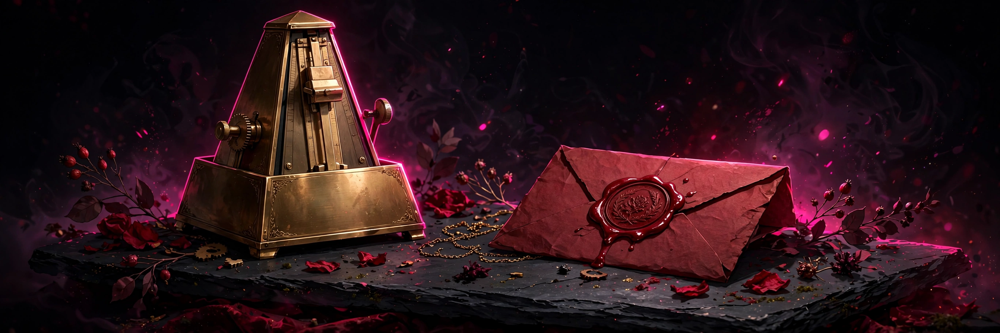

# By Heart

## 18+ — Adults Only

This game contains adult content. It is intended only for players 18 and older.

### Content notes

- A spoken command-and-response protocol that must be memorised — there is no paperwork
- A correction ladder on failure: train, correct, and retry, with the window tightening each rung
- Certain orders stay locked until a trigger phrase is spoken to arm them; even the right words are refused without permission

All characters depicted are adults.

## A memory game where you learn command-and-response pairs by heart and answer each order before its window closes.

<a href="https://github.com/NTRanch/by-heart">GitHub</a> · <a href="https://github.com/NTRanch/by-heart/blob/main/LICENSE.md">License</a> · <a href="https://ntranch.itch.io">itch.io studio page</a> · <a href="https://github.com/NTRanch/by-heart/releases/tag/v1.0.0">Release</a>

## Built with

  

## What you do

First she speaks the law: command, then response, pair by pair. Keep them by heart. Then the orders come, each on a timed window: choose the response and answer before the window closes. Answering inside the first half of the window is on the beat.

Fail, and the ladder climbs: train, correct, retry — the window tightening each rung. Three rungs fail the order; it is recorded, and the sitting goes on — there is no lockout. Some orders are locked: speak the trigger phrase to arm them before answering. The last orders come at speed. Settings (window grace, text size) and your record of sittings persist in the browser.

## Features

- Three levels: First Lessons (4 pairs, 6.0 s windows, 2 failures allowed), The Spoken Law (6 pairs, locked orders, 4.5 s windows), and By Heart (8 pairs, near-miss decoys, 3.5 s windows, flawless or lost)
- Locked orders that must be armed with a trigger phrase before an answer is accepted
- A persistent record — sittings kept, and sittings kept by heart — plus settings reachable before any play

## Media

- [Level 1 preview](../docs/previews/level-1-by-heart.mp4)
- [Level 2 preview](../docs/previews/level-2-by-heart.mp4)
- [Level 3 preview](../docs/previews/level-3-by-heart.mp4)

## Controls

| Action | Keys |
|---|---|
| Choose the response | Arrow keys |
| Answer the order | ENTER |
| Speak the trigger phrase and arm a locked order | B |

## Status

**v1.0.0** — complete. Built for the Torogao Jam Program (a 14-week, one-game-per-week programme) for the Gameotron jam on itch.io. This GitHub page is the game's home while itch project slots are unavailable. Open `web/index.html` — one self-contained file that runs fully offline. Free to play.

## Credits

A Nice Thoughts Ranch game.

Made with C++ and Unreal Engine.
